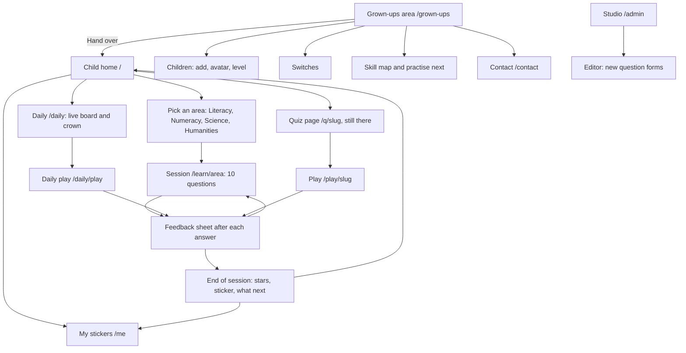

# Screens and look: child, parent, Studio

Stage 4 of the replan. Status: **PROPOSED, waiting for owner approval (Gate 2).** Design only; nothing here is built. It follows `docs/DIRECTION.md` (approved) and `docs/LEARNING-DESIGN.md` (proposed). It extends the Pop & Ink tokens in `src/index.css` and `docs/03-design/DESIGN-SYSTEM.md`; it does not replace them. Rule 3 holds: every existing route keeps working.

## 1. Who sees what

| Who | Where | Keyboard allowed? |
|---|---|---|
| Child (or guest) | home, session, feedback, end, stickers, daily, quiz pages | **Never.** Every answer and every control is a tap |
| Parent (signed in with an email code) | the new grown-ups area, `/contact`, `/account` | yes (contact form, reply box, child nicknames are picked, not typed) |
| Studio owner | `/admin/*` | yes |

Child mode and parent mode are separate. A parent hands the device over from the grown-ups area; leaving child mode needs the parent's sign-in again (email code). **Default I chose**, so a child cannot wander into settings. Guests (no parent) can try a short session; nothing is saved.

## 2. Screen map



| Screen | Route | Primary action | Status |
|---|---|---|---|
| Child home | `/` | Start today's session | **Change**: one home for phone and desktop (the two builds differ today) |
| Pick an area | on `/` (four big tiles) | Tap an area | **New** (replaces the subject grid as the first step; `/c/:slug` stays) |
| Session | `/learn/:area` | Answer | **New route**, same play stage |
| Quiz play | `/play/:slug`, `/daily/play`, `/challenge/:code/play` | Answer | **Exists**; gets the new look and types |
| Feedback sheet | in the play stage | Next | **Change**: right answer plus one-line reason always; no "Ranked" tag |
| End of session | in the play stage | Back to home | **Change**: stars, sticker, one next step |
| My stickers and progress | `/me` | Tap a sticker | **Change**: sticker book and area stars; the profile editing moves to grown-ups |
| Daily | `/daily` | Play today's challenge | **Exists** (live board, crown) |
| Who's playing | on `/` | Tap a child's avatar | **New** (only when a parent has added children) |
| Grown-ups area | `/grown-ups` | per tab | **New** |
| Contact | `/contact` | Send | **Exists**; reachable from grown-ups only for keyboard fields |
| Studio | `/admin/*` | per screen | **Exists**; editor gains the new question forms |

Everything else (`/leaderboards`, `/challenge/:code`, `/c/:slug`, `/q/:slug`, info pages, redirect stubs) keeps working. Public boards and friend challenges sit behind the parent switches from `DIRECTION.md`; the daily board stays on.

## 3. The child's flow

1. **Home.** The owl says hello by the child's preset nickname. One big button: **Start today's session** (10 questions, about 5 minutes, picks the area with the longest gap, retry-later questions first). Under it, four area tiles. Beside them the daily card with today's top score and crown. No typing, no menus.
2. **Pick an area (optional).** Tap Literacy, Numeracy, Science or Humanities. Each tile shows the child's stars for that area (see 5).
3. **Session.** One question per screen, no timer unless the parent turned on "Beat the clock". A small dot trail shows 10 questions. A speaker button reads the question aloud with the device's British voice (hidden if the device has none).
4. **Feedback sheet.** Right: a short cheer and the one-line reason. Wrong: "Not quite. The answer is **X**, because …", and the question is queued to come back later. One button: **Next**. Correct and wrong are never colour alone: tick or cross icon plus words.
5. **End of session.** Stars filled for this area (1 to 5), one sticker if earned, the owl reacts, and one next step: **Another 5 minutes** or **Back home**. No score ranking here; on the daily, the crown banner and live board as built.
6. **My stickers.** A book of preset stickers (finish a first session, a 3-day streak, a perfect round, a first correct spell, ...). Locked ones show as outlines with how to earn them in plain words.

## 4. Question screens

All share one layout: question at the top (sentence case, never forced capitals), the answer area in the middle, the action at the bottom within thumb reach. Tap targets are **56 px or more** on every answer, tile and slot (the design system's 48 px stays the floor elsewhere). Wireframes are for the three new interaction screens.

### Tile build (spell, dictation, fill the gap, order the cards)

```
 ┌──────────────────────────────┐
 │  ◀ Leave        4 of 10  ●●●●○○○○○○ │
 │                              │
 │  Spell the word      [🔊]    │   speaker reads it aloud
 │  "a big yellow fruit that    │
 │   monkeys like"              │
 │                              │
 │   ┌──┐ ┌──┐ ┌──┐ ┌──┐ ┌──┐ ┌──┐ │   slots (tap a filled slot to remove)
 │   │b │ │a │ │  │ │  │ │  │ │  │ │
 │   └──┘ └──┘ └──┘ └──┘ └──┘ └──┘ │
 │                              │
 │   [n] [a] [b] [x] [a] [n]    │   tiles: big, chunky, pressed edge
 │                              │
 │  [ Undo ]        [ Check ]   │   Check lights up when all slots are full
 └──────────────────────────────┘
```

- A tapped tile moves into the next free slot; tapping a slot sends its tile back. **Undo** removes the last tile. No dragging is needed anywhere (dragging may be added as a bonus later, never required).
- Gap variant: the slots sit inside the sentence ("The cat ___ on the mat."); word chips below. Order variant: cards are wider and fill vertical slots numbered 1 to n.
- Keyboard and screen reader: Tab moves through tiles, Enter or Space places the tile, the live region says "b placed in slot 1 of 6". Wrong or right is announced after Check.

### Assign (match pairs, sort into groups)

```
 ┌──────────────────────────────┐
 │  Sort these into groups      │
 │  Tap an item, then its group │
 │                              │
 │   [ cat ]  [ oak ]  [ trout ]│   items (the picked one glows sun-yellow)
 │   [ rose ] [ eagle ]         │
 │                              │
 │  ┌─Plants───┐ ┌─Animals───┐  │   groups: tap to send the picked item
 │  │ oak      │ │ cat       │  │   placed items show inside, tap to take back
 │  │ rose     │ │           │  │
 │  └──────────┘ └───────────┘  │
 │                  [ Check ]   │   enabled when every item is placed
 └──────────────────────────────┘
```

Match pairs uses two columns (item, partner) and draws a small link between a chosen pair; sort uses group boxes as above. At most 6 items and 3 groups, so it fits at 390 px.

### Number tiles (the default for numbers)

```
 ┌──────────────────────────────┐
 │  What is 7 × 8?              │
 │            ┌──────┐          │
 │            │  56  │ units    │   the answer so far, big
 │            └──────┘          │
 │     [1] [2] [3]              │
 │     [4] [5] [6]              │   keypad of tiles, 56 px, no keyboard
 │     [7] [8] [9]              │
 │     [⌫] [0] [ . ]  (− if needed) │
 │               [ Check ]      │
 └──────────────────────────────┘
```

Existing slider questions use this screen by default (same data, same server check). The slider stays for parents who switch "Slider questions" on.

## 5. Progress the child sees

Stars only, never percentages or ranks: five stars per area, filled by the child's current **step** (1 to 5) inside their level. Stars rise and fall gently with the steps in `LEARNING-DESIGN.md`. The sticker book is the other reward. Nothing compares a child with other children except the daily board and crown, which show nickname, preset avatar and score only.

## 6. The grown-ups area `/grown-ups`

Sign-in is Clerk (email code, plus Google where enabled). Tabs on one page, all with large controls, all reachable by keyboard.

| Tab | What it does | Notes |
|---|---|---|
| Children | add a child (pick a preset nickname and avatar from a short list; no typing, no real name), pick a **level** (Starters 4-5 ... Scholars 15-16, shown as a year hint, never stored as the child's age), remove a child | up to 5 children per parent (my default) |
| Switches | the six parent switches from `DIRECTION.md`, all off by default, plus **Sound** and **Easy-read font** | one place, plain wording and a line saying what each does |
| Skill map | per child and area: topics as small bars, steps 1 to 5, last 4 sessions | numbers are for parents only; the child sees stars |
| Practise next | a short list of the topics where the child struggled, with a **Start with {child}** button that hands the device over | uses the retry queue |
| Contact | link to the contact form and the reply box | the only keyboard fields in the product besides sign-in |
| Hand over | **Give the device to {child}** switches to child mode | leaving child mode needs the email code again |

Empty states are invitations ("Add your first child to start"); errors say what went wrong and what to do.

## 7. Studio

Unchanged except the editor and import. New question forms (additive): `build` (type of tiles, the tile list including decoys, the accepted sequence, optional spoken text, a practice-only note for dictation) and `assign` (items, groups, the key). Each form shows a live preview of what the child sees, using the same components. Validation mirrors `Content.php`. The AI helpers stay as they are.

## 8. Look: extend, do not replace

**Direction.** Keep Pop & Ink (grape, lemon, tangerine, lagoon, bubblegum on mist, Outfit and Baloo 2). It is already friendly and distinct; the brief is to make it calmer and clearer, not new. **Spend the boldness in one place:** the tile. Chunky, tactile letter and word tiles with the existing pressed-edge shadow are the memorable object in the product; everything around them stays quiet.

### Stage colours become tokens

The play stage uses hard-coded hex values today (`index.css` lines 120 to 301, `FeedbackPanel.tsx`, `SliderAnswer.tsx`, `PlayPage.tsx`). Proposed replacements, all measured:

| Today | Token | Measured |
|---|---|---|
| `#17153a` ink | `content` (exists) | 17.4 : 1 on white |
| `#fff` card face | `surface` (exists) | |
| `#4A4770` explanation | `content-muted` (exists, slightly lighter) | 6.3 : 1 on mist |
| `#6C4CF5` link | `primary` (exists) | 5.3 : 1 on white |
| `#5A5680` | `content-muted` (exists) | 5.7 : 1 |
| `#ECE8F6` track | `surface-border` (exists) | |
| `#1FB57A` countdown bar | new `correct-soft` | decorative |
| `#c8f0da / #0b6b43 / #8fd8b1` right answer | new `right-fill`, `right-ink`, `right-edge` | ink on fill 5.3 : 1 |
| `#ffe3df / #b0262a / #e5484d` wrong answer | new `wrong-fill`, `wrong-ink`, `wrong-edge` | ink on fill 5.5 : 1 |
| `--fc #2d9be0`, `--fd #0b5fa8` frame and answer border | new `stage-frame`, `stage-edge` per world | answer text on white 6.5 : 1; white on frame 3.1 : 1, large bold text only |
| `--sky-top/bot` per result | new `stage-right-sky`, `stage-wrong-sky` | ink on them 9.4 : 1 and 6.4 : 1 |

No other new colours. Dark mode values are chosen alongside each new token when it is built.

### Type and text

- No forced capitals: remove `text-transform: uppercase` from `.stage-answer`, `.stage-pill`, the stage headings and the slider button (`index.css` lines 206 and 264, `FeedbackPanel`, `SliderAnswer`, `PlayPage`). Sentence case everywhere; early readers read capitals slowly.
- Sizes: question 1.5 to 1.75 rem, answers and tiles 1.25 rem or larger, letter tiles 2 rem, line length under 60 characters.
- **Easy-read font** (parent switch, per child): Atkinson Hyperlegible, self-hosted through `@fontsource`, with wider letter and line spacing and no italics. This is a legibility-first face, which suits readers with dyslexia, though no font is a cure. **Assumption**; the owner can pick another (OpenDyslexic is the common alternative).

### Motion, sound and the owl

- GSAP, short, transform and opacity only, nothing under reduced motion: a tile slides into its slot (150 ms); a wrong check gives one gentle nudge, never a flash; the sticker pops once; the owl blinks or nods on a right answer. Entrances run once per screen.
- Sound is off until a parent turns it on: a soft tap, a chime for right, a rustle for a sticker. Made with the Web Audio API, no files to host.
- The owl (already in `Art.tsx`) is the mascot; other characters stay as avatars. No new illustration set is needed for P1 to P4.

### Accessibility checklist (every new screen)

- Targets 56 px or more; 8 px or more between targets; visible focus ring on every control.
- Right and wrong always have an icon and words; no meaning by colour alone; no flashing.
- Every control has an accessible name from `src/i18n/en-GB.ts`; live regions announce placement, check results and sticker earned.
- Works with one finger and with a keyboard; never needs dragging, hovering or a long press.
- Reduced motion respected; easy-read font and sound honour the parent's switches.
- Plain, kind language at a reading age of about 8.

## 9. States every screen needs

| State | Child screens | Grown-ups |
|---|---|---|
| Loading | owl with a soft pulse, "Getting your questions ready" | skeleton rows |
| Empty | "No stickers yet. Finish a session to get your first." | "Add your first child" |
| Error | "That didn't load. Try again" with one button; progress is never lost | what failed and what to do |
| Offline | banner exists; a session in progress says it needs the internet | same |
| No questions left for this level and area | "You've done them all! Try another area." | shown in the skill map |
| Sign-in needed | not applicable | email code step, clear errors |

## 10. Assumptions and what I need from you

- **ASSUMPTION** One home for phone and desktop; the second home build is folded in, not deleted until the new one passes the same tests.
- **ASSUMPTION** Child mode is locked by the parent's email code (no PIN).
- **ASSUMPTION** Atkinson Hyperlegible for the easy-read option; up to 5 children per parent; sticker book of about 20 stickers to start.
- **Owner decision, 7 Nov 2026:** Religious knowledge stays Christian only (see `LEARNING-DESIGN.md`).
- **NOT TESTED** Everything here is a design; no screen has been built or screenshotted in its new form.

Proof plan for the build (Stage 7): each phase screenshots every changed screen at 390, 834 and 1280 wide, runs the axe audit with zero violations, checks no horizontal overflow and the 56 px targets, and plays it through before any "done".
